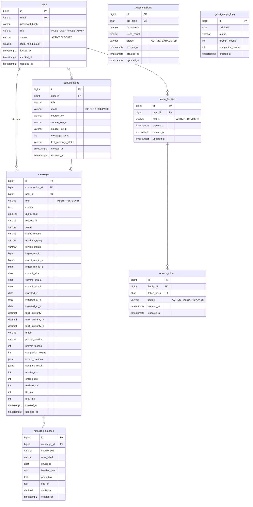
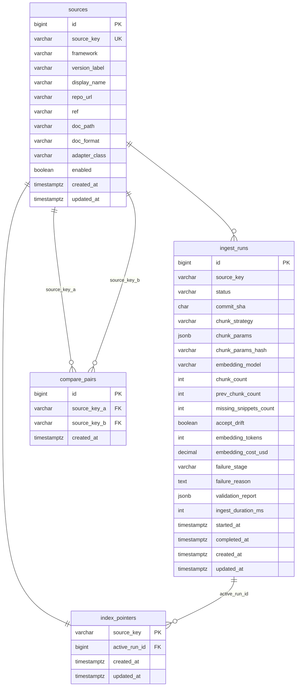

# 데이터베이스 스키마 설계

> 최종 수정일: 2026-10-01

---

## 0. ERD

- ERD 도구: ERDCloud
- ERD 링크:
  - app 스키마 ERD (Auth · Guest · Conversation): \[TBD\]
  - ai 스키마 ERD (Index · 수집 이력): \[TBD\]

---

## 1. 도메인

### 1.1 주요 도메인

| 도메인 | 설명 | 주요 속성 | 스키마 | 소유 서비스 |
| --- | --- | --- | --- | --- |
| Auth (인증) | 사용자 계정, JWT 패밀리·Refresh Token 회전, 로그인 잠금 | email, password_hash, role(ROLE_USER/ROLE_ADMIN), login_failed_count, token_hash | app | backend |
| Guest (게스트) | 비로그인 세션 식별, 5회 이용 한도, IP 발급 제한 | sid_hash(SHA-256), used_count(0\~5), ip_address, expires_at | app | backend |
| Conversation (대화) | 버전·모드 고정 학습 세션, 메시지·출처 영구 이력 | mode(SINGLE/COMPARE), source_key(s), message_count, status(파생) | app | backend |
| Index (인덱스) | 소스 카탈로그, 수집 실행 이력, 활성 인덱스 포인터 | source_key, commit_sha, chunk_params, ACTIVE/SUPERSEDED/PURGED | ai | ai-server |

### 1.2 도메인 관계

**스키마 소유권 및 쓰기 규칙:**

- `app` ← Flyway 마이그레이션, backend 독점 쓰기
- `ai` ← Alembic 마이그레이션, ai-server 독점 쓰기
- backend는 `ai.sources`, `ai.index_pointers` **읽기만** 허용. 나머지 ai 테이블 직접 접근 불가

**서비스 간 참조 (ID·VARCHAR 저장, DB FK 없음):**

- `app.conversations.source_key` → `ai.sources.source_key`
- `app.messages.ingest_run_id` → `ai.ingest_runs.id`
- `app.message_sources.source_key` → `ai.sources.source_key` (값 스냅샷)

**app 스키마 내 관계 (FK 적용):**

- `users` 1:N `token_families` 1:N `refresh_tokens`
- `users` 1:N `conversations` 1:N `messages` 1:N `message_sources`
- `messages.user_id` → `users.id` (비정규화, FK 적용)

**ai 스키마 내 관계 (FK 적용):**

- `sources` 1:N `ingest_runs`
- `sources` 1:1 `index_pointers` → `active_run_id` → `ingest_runs`
- `sources` 1:N `compare_pairs` (source_key_a, source_key_b 양측)

---

## 2. 테이블 목록

| 테이블명 | 스키마 | 설명 | 주요 컬럼 | 관련 도메인 | IMMUTABLE |
| --- | --- | --- | --- | --- | --- |
| users | app | 회원 계정 | email, password_hash, role, status, login_failed_count, locked_at | Auth |  |
| token_families | app | Refresh Token 패밀리 (로그인 세션 단위) | user_id, status, expires_at | Auth |  |
| refresh_tokens | app | 회전형 Refresh Token | family_id, token_hash, status | Auth |  |
| guest_sessions | app | 비로그인 세션 | sid_hash, ip_address, used_count, status, expires_at | Guest |  |
| guest_usage_logs | app | 게스트 이용량 집계 로그 | sid_hash, status, prompt_tokens, completion_tokens | Guest | ✓ |
| conversations | app | 사용자 대화 세션 (버전·모드 고정) | user_id, mode, source_key(s), message_count, last_message_status | Conversation |  |
| messages | app | 대화 내 메시지 (USER/ASSISTANT) | conversation_id, role, content, status, 스냅샷 메타 전체 | Conversation |  |
| message_sources | app | ASSISTANT 메시지 출처 스냅샷 | message_id, rank_label, chunk_id, heading_path, permalink, similarity | Conversation | ✓ |
| sources | ai | 소스 카탈로그 (버전별 저장소 정보) | source_key, framework, version_label, enabled, adapter_class | Index |  |
| compare_pairs | ai | 비교 가능 소스 쌍 정의 | source_key_a, source_key_b | Index | ✓ |
| ingest_runs | ai | 수집 실행 이력·인덱스 빌드 레코드 | source_key, status, commit_sha, chunk_params, validation_report | Index |  |
| index_pointers | ai | 소스별 활성 인덱스 포인터 (원자적 교체) | source_key(PK), active_run_id | Index |  |

---

## 3. 테이블 상세

### 3.1 app.users

**컬럼**

| 컬럼 | 타입 | 제약 | 설명 |
| --- | --- | --- | --- |
| id | BIGINT | PK | GENERATED ALWAYS AS IDENTITY |
| email | VARCHAR(254) | NOT NULL | 소문자 정규화·앞뒤 공백 제거 후 저장. 최대 254자 |
| password_hash | VARCHAR(72) | NOT NULL | BCrypt cost 10. 해시 최대 60자 + 여유 |
| role | VARCHAR(30) | NOT NULL | ROLE_USER / ROLE_ADMIN. 계정당 1개 |
| status | VARCHAR(30) | NOT NULL | ACTIVE / LOCKED |
| login_failed_count | SMALLINT | NOT NULL | 0\~5. 성공 시 0으로 초기화 |
| locked_at | TIMESTAMPTZ(6) | NULL | 5번째 실패 시각. 성공 시 NULL로 초기화 |
| created_at | TIMESTAMPTZ(6) | NOT NULL |  |
| updated_at | TIMESTAMPTZ(6) | NOT NULL |  |

**제약 및 인덱스**

| 이름 | 컬럼 | 설명 |
| --- | --- | --- |
| pk_users | id | PK |
| uq_users_email | email | UNIQUE. 소문자 정규화 후 중복 불가 |
| chk_users_failed_count | login_failed_count | CHECK (login_failed_count BETWEEN 0 AND 5) |
| idx_users_status_locked | (status, locked_at) | LOCKED 계정 조회·잠금 만료 판정 |

**상태값 — status**

| 상태 | 의미 | 변경 가능 조건 |
| --- | --- | --- |
| ACTIVE | 정상 계정 | 15분 내 5회 실패 시 → LOCKED |
| LOCKED | 로그인 잠금 (15분) | locked_at + 15분 경과 → 조회 시 자동 ACTIVE로 판정. DB 갱신은 다음 로그인 성공 시 |

> **설계 판단:** LOCKED 만료 여부는 `locked_at + INTERVAL '15 minutes' > NOW()` 런타임 판정. 별도 스케줄러 불필요.

---

### 3.2 app.token_families

**컬럼**

| 컬럼 | 타입 | 제약 | 설명 |
| --- | --- | --- | --- |
| id | BIGINT | PK | GENERATED ALWAYS AS IDENTITY |
| user_id | BIGINT | NOT NULL, FK(users.id) |  |
| status | VARCHAR(30) | NOT NULL | ACTIVE / REVOKED |
| expires_at | TIMESTAMPTZ(6) | NOT NULL | 로그인 시각 + 7일. 절대 만료 (회전해도 연장 없음) |
| created_at | TIMESTAMPTZ(6) | NOT NULL | 로그인 시각 |
| updated_at | TIMESTAMPTZ(6) | NOT NULL |  |

**제약 및 인덱스**

| 이름 | 컬럼 | 설명 |
| --- | --- | --- |
| pk_token_families | id | PK |
| fk_tf_user | user_id → users(id) | NO CASCADE |
| idx_tf_user_status | (user_id, status) | 사용자별 ACTIVE 패밀리 조회·10개 초과 정리 |
| idx_tf_expires_at | expires_at | 만료 패밀리 배치 정리 |

**상태값 — status**

| 상태 | 의미 | 변경 가능 조건 |
| --- | --- | --- |
| ACTIVE | 유효한 로그인 세션 | 로그아웃·재사용 탐지·10개 초과 → REVOKED |
| REVOKED | 무효화 (종결) | 레코드는 expires_at + 1일까지 보관 후 물리 삭제 |

> 사용자당 ACTIVE 패밀리 최대 10개. 초과 시 가장 오래된 패밀리 REVOKED.

---

### 3.3 app.refresh_tokens

**컬럼**

| 컬럼 | 타입 | 제약 | 설명 |
| --- | --- | --- | --- |
| id | BIGINT | PK | GENERATED ALWAYS AS IDENTITY |
| family_id | BIGINT | NOT NULL, FK(token_families.id) |  |
| token_hash | CHAR(64) | NOT NULL, UNIQUE | SHA-256(256비트 불투명 난수) hex. 원본은 HttpOnly 쿠키에만 존재 |
| status | VARCHAR(30) | NOT NULL | ACTIVE / USED / REVOKED |
| created_at | TIMESTAMPTZ(6) | NOT NULL | 발급 시각 |
| updated_at | TIMESTAMPTZ(6) | NOT NULL | 상태 변경 시각 |

**제약 및 인덱스**

| 이름 | 컬럼 | 설명 |
| --- | --- | --- |
| pk_refresh_tokens | id | PK |
| uq_rt_token_hash | token_hash | UNIQUE. 회전 시 해시 조회 + 재사용 탐지 기준 |
| fk_rt_family | family_id → token_families(id) | NO CASCADE |
| idx_rt_family_status | (family_id, status) | 패밀리별 ACTIVE 토큰 조회·전체 REVOKE |

**상태값 — status**

| 상태 | 의미 | 변경 가능 조건 |
| --- | --- | --- |
| ACTIVE | 사용 가능 | 회전 성공 → USED |
| USED | 회전으로 소진 | 유예 5초 이내 재제출 → CONFLICT(409). 이후 재제출 → 패밀리 전체 REVOKED (재사용 탐지) |
| REVOKED | 명시적 무효화 (종결) | 로그아웃·재사용 탐지·패밀리 REVOKE에 의해 전환 |

> **정합성 (INV-15):** 패밀리당 ACTIVE 토큰 최대 1개. 회전은 기존 ACTIVE → USED, 신규 ACTIVE 발급을 단일 트랜잭션으로 처리.
> 
> **TTL:** 패밀리 `expires_at + 1일` 후 물리 삭제 (일 1회 배치).

---

### 3.4 app.guest_sessions

**컬럼**

| 컬럼 | 타입 | 제약 | 설명 |
| --- | --- | --- | --- |
| id | BIGINT | PK | GENERATED ALWAYS AS IDENTITY |
| sid_hash | CHAR(64) | NOT NULL, UNIQUE | SHA-256(devdocs_sid 쿠키 값) hex |
| ip_address | VARCHAR(45) | NOT NULL | IPv4 최대 15자 / IPv6 최대 45자. IP당 신규 세션 한도 집계용 |
| used_count | SMALLINT | NOT NULL | 0 이상 5 이하 (INV-16) |
| status | VARCHAR(30) | NOT NULL | ACTIVE / EXHAUSTED |
| expires_at | TIMESTAMPTZ(6) | NOT NULL | 최초 발급 시각 + 24시간. 절대 만료 (사용해도 연장 없음) |
| created_at | TIMESTAMPTZ(6) | NOT NULL | 발급 시각 (최초 질문 API 호출 시. 페이지 진입만으로는 발급 안 함) |
| updated_at | TIMESTAMPTZ(6) | NOT NULL | used_count / status 변경 시각 |

**제약 및 인덱스**

| 이름 | 컬럼 | 설명 |
| --- | --- | --- |
| pk_guest_sessions | id | PK |
| uq_gs_sid_hash | sid_hash | UNIQUE. 쿠키 제출 시 해시 조회 |
| chk_gs_used_count | used_count | CHECK (used_count BETWEEN 0 AND 5) |
| idx_gs_ip_created | (ip_address, created_at) | IP당 1시간 내 신규 세션 발급 횟수 집계 (GUEST_SESSION_LIMIT) |
| idx_gs_expires_at | expires_at | 만료 레코드 배치 정리 |

**상태값 — status**

| 상태 | 의미 | 변경 가능 조건 |
| --- | --- | --- |
| ACTIVE | 잔여 횟수 존재 | used_count = 5 → EXHAUSTED |
| EXHAUSTED | 한도 소진 | meta 이벤트 전송 이전 서버 오류 시 1회 환불 → ACTIVE |

> **차감 (원자적):** `UPDATE ... SET used_count = used_count + 1 WHERE sid_hash = ? AND used_count < 5 AND expires_at > NOW()`. 영향 행 0 → `GUEST_QUOTA_EXCEEDED`(429).
> 
> **TTL:** `expires_at + 24시간` 후 물리 삭제 (일 1회 배치).

---

### 3.5 app.guest_usage_logs \[IMMUTABLE\]

**컬럼**

| 컬럼 | 타입 | 제약 | 설명 |
| --- | --- | --- | --- |
| id | BIGINT | PK | GENERATED ALWAYS AS IDENTITY |
| sid_hash | CHAR(64) | NOT NULL | 게스트 세션 해시 참조. FK 없음 (세션 삭제 후에도 집계 보관) |
| status | VARCHAR(30) | NOT NULL | messages와 동일 상태 모델: COMPLETED / PARTIAL / NO_CONTEXT / FAILED |
| prompt_tokens | INT | NULL | LLM 호출 발생 시 채워짐 |
| completion_tokens | INT | NULL |  |
| created_at | TIMESTAMPTZ(6) | NOT NULL | \[IMMUTABLE\] |

**제약 및 인덱스**

| 이름 | 컬럼 | 설명 |
| --- | --- | --- |
| pk_guest_usage_logs | id | PK |
| idx_gul_sid_hash | sid_hash | 세션별 사용 이력 조회 |
| idx_gul_created_at | created_at | 관리자 대시보드 일별 집계 |

> 게스트 대화는 DB에 저장하지 않음(정책 1.3). 토큰 비용 추적·관리자 대시보드 집계용 최소 로그만 기록.

---

### 3.6 app.conversations

**컬럼**

| 컬럼 | 타입 | 제약 | 설명 |
| --- | --- | --- | --- |
| id | BIGINT | PK | GENERATED ALWAYS AS IDENTITY |
| user_id | BIGINT | NOT NULL, FK(users.id) |  |
| title | VARCHAR(40) | NOT NULL | 첫 USER 메시지 앞 40자 (줄바꿈 제거). LLM 제목 생성 미사용 |
| mode | VARCHAR(30) | NOT NULL | SINGLE / COMPARE. 생성 후 불변 (INV-10) |
| source_key | VARCHAR(50) | NULL | SINGLE 모드. ai.sources.source_key 참조 (FK 없음, 서비스 간) |
| source_key_a | VARCHAR(50) | NULL | COMPARE 모드 A측 (구버전). ai.sources 참조 |
| source_key_b | VARCHAR(50) | NULL | COMPARE 모드 B측 (신버전). ai.sources 참조 |
| message_count | INT | NOT NULL | 총 메시지 수 (USER + ASSISTANT). 100개 상한 검사·목록 표시용 비정규화 |
| last_message_status | VARCHAR(30) | NULL | 최신 ASSISTANT 메시지 status. 목록 표시용 비정규화 |
| created_at | TIMESTAMPTZ(6) | NOT NULL |  |
| updated_at | TIMESTAMPTZ(6) | NOT NULL | ASSISTANT 메시지 종결 시 갱신. 대화 목록 정렬 기준 |

**제약 및 인덱스**

| 이름 | 컬럼 | 설명 |
| --- | --- | --- |
| pk_conversations | id | PK |
| fk_conv_user | user_id → users(id) | NO CASCADE |
| chk_conv_mode_source | mode, source_key(s) | SINGLE: source_key NOT NULL, source_key_a/b NULL. COMPARE: source_key NULL, source_key_a/b NOT NULL |
| idx_conv_user_updated | (user_id, updated_at DESC) | 대화 목록 커서 기반 페이지네이션 (20개) |

**모드별 컬럼 적용 규칙**

| 컬럼 | SINGLE | COMPARE |
| --- | --- | --- |
| source_key | NOT NULL | NULL |
| source_key_a | NULL | NOT NULL |
| source_key_b | NULL | NOT NULL |

**파생 상태 (DB 저장 안 함)**

| 상태 | 판정 조건 | 클라이언트 결과 |
| --- | --- | --- |
| OPEN | message_count \< 100 AND 소스 활성 (enabled=true AND ACTIVE run 존재) | 이어서 질문 가능 |
| READ_ONLY | message_count >= 100 OR 소스 비활성 | CONVERSATION_FULL(409) / SOURCE_UNAVAILABLE(409) |

---

### 3.7 app.messages

> 역할(role)과 모드(SINGLE/COMPARE)에 따라 적용 컬럼이 달라진다. 해당 범위 밖 컬럼은 NULL.

**컬럼**

| 컬럼 | 타입 | 제약 | 적용 범위 | 설명 |
| --- | --- | --- | --- | --- |
| id | BIGINT | PK | ALL | GENERATED ALWAYS AS IDENTITY |
| conversation_id | BIGINT | NOT NULL, FK(conversations.id) | ALL |  |
| user_id | BIGINT | NOT NULL, FK(users.id) | ALL | 비정규화. 일일 할당량 COUNT 최적화 |
| role | VARCHAR(30) | NOT NULL | ALL | USER / ASSISTANT |
| content | TEXT | NULL | USER, ASSISTANT SINGLE | USER: 질문 원문. ASSISTANT SINGLE: 누적 응답 본문. COMPARE ASSISTANT는 NULL (compare_result 사용) |
| quota_cost | SMALLINT | NULL | USER만 | 일일 할당량 차감 단위. SINGLE=1, COMPARE=2 |
| request_id | VARCHAR(36) | NULL | ASSISTANT만 | X-Request-Id UUID. 모든 로그·오류 응답에 포함 |
| status | VARCHAR(30) | NULL | ASSISTANT만 | 상태값 참조 |
| status_reason | VARCHAR(50) | NULL | ASSISTANT만 | PARTIAL/FAILED/NO_CONTEXT 세부 사유 |
| finish_reason | VARCHAR(20) | NULL | ASSISTANT SINGLE만 | OpenAI finish_reason (stop / length) |
| rewritten_query | VARCHAR(200) | NULL | ASSISTANT만 | 재작성 질의. 첫 질문·SKIPPED 시 NULL |
| rewrite_status | VARCHAR(20) | NULL | ASSISTANT만 | OK / FALLBACK / SKIPPED |
| ingest_run_id | BIGINT | NULL | ASSISTANT SINGLE만 | ai.ingest_runs.id 값 스냅샷. FK 없음 (서비스 간) |
| ingest_run_id_a | BIGINT | NULL | ASSISTANT COMPARE만 | A측 run ID 값 스냅샷 |
| ingest_run_id_b | BIGINT | NULL | ASSISTANT COMPARE만 | B측 run ID 값 스냅샷 |
| commit_sha | CHAR(40) | NULL | ASSISTANT SINGLE만 | 수집 커밋 SHA 값 스냅샷 (INV-13) |
| commit_sha_a | CHAR(40) | NULL | ASSISTANT COMPARE만 | A측 커밋 SHA 값 스냅샷 |
| commit_sha_b | CHAR(40) | NULL | ASSISTANT COMPARE만 | B측 커밋 SHA 값 스냅샷 |
| ingested_at | DATE | NULL | ASSISTANT SINGLE만 | 수집일 값 스냅샷. ai-server meta 이벤트에서 복사 |
| ingested_at_a | DATE | NULL | ASSISTANT COMPARE만 | A측 수집일 값 스냅샷 |
| ingested_at_b | DATE | NULL | ASSISTANT COMPARE만 | B측 수집일 값 스냅샷 |
| top1_similarity | DECIMAL(5,4) | NULL | ASSISTANT SINGLE만 | 검색 top-1 유사도 (0.0000\~1.0000) |
| top1_similarity_a | DECIMAL(5,4) | NULL | ASSISTANT COMPARE만 | A측 top-1 유사도 |
| top1_similarity_b | DECIMAL(5,4) | NULL | ASSISTANT COMPARE만 | B측 top-1 유사도 |
| model | VARCHAR(50) | NULL | ASSISTANT만 | 실제 사용 LLM 모델명. 환경변수와 무관하게 값으로 저장 |
| prompt_version | VARCHAR(50) | NULL | ASSISTANT만 | e.g., single_v3. prompts/ 디렉터리 파일명 |
| prompt_tokens | INT | NULL | ASSISTANT만 |  |
| completion_tokens | INT | NULL | ASSISTANT만 |  |
| invalid_citations | JSONB | NULL | ASSISTANT만 | 범위 밖 인용 번호 배열. e.g., \[3, 5\] |
| compare_result | JSONB | NULL | ASSISTANT COMPARE만 | 후처리 검증 완료 JSON (정책 5.6 구조) |
| rewrite_ms | INT | NULL | ASSISTANT만 | 재작성 지연 ms |
| embed_ms | INT | NULL | ASSISTANT만 | 임베딩 지연 ms |
| retrieve_ms | INT | NULL | ASSISTANT만 | 검색 지연 ms |
| ttft_ms | INT | NULL | ASSISTANT SINGLE만 | 첫 토큰까지 ms |
| total_ms | INT | NULL | ASSISTANT만 | 전체 처리 ms |
| created_at | TIMESTAMPTZ(6) | NOT NULL | ALL |  |
| updated_at | TIMESTAMPTZ(6) | NOT NULL | ALL | 상태 전이·종결 시 갱신 |

**제약 및 인덱스**

| 이름 | 컬럼 | 설명 |
| --- | --- | --- |
| pk_messages | id | PK |
| fk_msg_conv | conversation_id → conversations(id) | NO CASCADE |
| fk_msg_user | user_id → users(id) | NO CASCADE |
| idx_msg_conv_created | (conversation_id, created_at) | 대화 상세 조회 (메시지 시간순 정렬) |
| idx_msg_conv_role_status | (conversation_id, role, status) | INV-11: 진행 중 ASSISTANT 메시지 존재 여부 검사 |
| idx_msg_user_quota | (user_id, role, created_at DESC) | 일일 할당량: SUM(quota_cost) WHERE role='USER' AND created_at >= 오늘 KST 00:00 |

**상태값 — status** (ASSISTANT 메시지만)

| 상태 | 모드 | 의미 | 변경 가능 조건 |
| --- | --- | --- | --- |
| PENDING | BOTH | 요청 수락·검증 완료, 처리 시작 전 | ai-server 호출 → STREAMING(단일) 또는 PROCESSING(비교) |
| STREAMING | SINGLE | meta 수신 후 토큰 스트리밍 중 | done / error / 클라이언트 취소 시 종결 |
| PROCESSING | COMPARE | ai-server 비교 처리 중 | 결과 수신·타임아웃·오류 시 종결 |
| COMPLETED | BOTH | 정상 완료 | 종결 상태. 나가는 전이 없음 (INV-12) |
| PARTIAL | SINGLE | 토큰 >= 1 수신 후 중단 | 종결 상태 |
| NO_CONTEXT | BOTH | 근거 없음 (LOW_SIMILARITY 또는 LLM_ABSTAIN) | 종결 상태 |
| FAILED | BOTH | 오류·연결 실패·고착 | 종결 상태 |

**status_reason 값**

| status_reason | 발생 조건 |
| --- | --- |
| LOW_SIMILARITY | top-1 \< tau → NO_CONTEXT. LLM 미호출 (INV-07) |
| LLM_ABSTAIN | sentinel \[\[NO_ANSWER\]\] 감지 → NO_CONTEXT |
| CLIENT_ABORTED | 클라이언트 연결 끊김 |
| UPSTREAM_IDLE_TIMEOUT | 유휴 30초 초과 |
| LENGTH | max_tokens 도달 |
| MAX_DURATION | 스트림 최대 120초 초과 |
| STALE | 150초 고착 (스위퍼 판정) |
| PERSIST_ERROR | 종결 후 DB 저장 실패 |
| AI_UNAVAILABLE | ai-server 연결 실패 (3초 타임아웃) |
| UPSTREAM_TIMEOUT | 첫 이벤트 15초 / 비교 30초 초과 |
| LLM_ERROR | OpenAI 오류 |
| COMPARE_PARSE_ERROR | 비교 JSON 파싱 2회 실패 |

**저장 시점 (정책 6.3)**

| 시점 | 동작 |
| --- | --- |
| 1. 요청 수락 | USER 메시지 INSERT + ASSISTANT PENDING INSERT (동일 트랜잭션). INV-11 검사 포함 |
| 2. meta 수신 | ASSISTANT → STREAMING, 출처·스냅샷 정보 UPDATE (ingest_run_id, commit_sha, ingested_at 등) |
| 3. 토큰 수신 | backend 메모리 버퍼 누적. 토큰마다 DB 쓰기 금지 |
| 4. 종결 | 누적 본문 + 사용량·지연 포함 단일 UPDATE. conversations.updated_at·last_message_status 동시 갱신 |

---

### 3.8 app.message_sources \[IMMUTABLE\]

**컬럼**

| 컬럼 | 타입 | 제약 | 설명 |
| --- | --- | --- | --- |
| id | BIGINT | PK | GENERATED ALWAYS AS IDENTITY |
| message_id | BIGINT | NOT NULL, FK(messages.id) | NO CASCADE |
| source_key | VARCHAR(50) | NOT NULL | 어느 버전 인덱스에서 왔는지. 값 스냅샷 (FK 없음, 서비스 간) |
| rank_label | VARCHAR(5) | NOT NULL | SINGLE: "1","2",... / COMPARE: "A1","B2",... (최대 "A10") |
| chunk_id | CHAR(32) | NOT NULL | SHA-256 결정적 식별자 앞 32자 |
| heading_path | TEXT | NOT NULL | e.g., "Agents > Tools > Defining tools" |
| permalink | TEXT | NOT NULL | commit SHA 고정 GitHub URL. 불변 출처 (INV-05) |
| site_url | TEXT | NULL | 문서 사이트 URL. 구조 개편 시 무효화 가능 (보조 링크) |
| similarity | DECIMAL(5,4) | NOT NULL | cosine similarity (0.0000\~1.0000) |
| created_at | TIMESTAMPTZ(6) | NOT NULL | \[IMMUTABLE\] |

**제약 및 인덱스**

| 이름 | 컬럼 | 설명 |
| --- | --- | --- |
| pk_message_sources | id | PK |
| fk_ms_message | message_id → messages(id) | NO CASCADE |
| idx_ms_message_id | message_id | 메시지별 출처 목록 조회 |

> **설계 판단:** 출처는 청크 참조가 아닌 값(heading_path, permalink, similarity)으로 복사 저장 (INV-13). 인덱스 교체·PURGED 이후에도 이력 유지.

---

### 3.9 ai.sources

**컬럼**

| 컬럼 | 타입 | 제약 | 설명 |
| --- | --- | --- | --- |
| id | BIGINT | PK | GENERATED ALWAYS AS IDENTITY |
| source_key | VARCHAR(50) | NOT NULL, UNIQUE | e.g., langchain_v03, langchain_v1x |
| framework | VARCHAR(50) | NOT NULL | e.g., langchain |
| version_label | VARCHAR(20) | NOT NULL | e.g., v0.3, v1.x |
| display_name | VARCHAR(100) | NOT NULL | UI 표시명. e.g., LangChain |
| repo_url | VARCHAR(200) | NOT NULL | e.g., langchain-ai/langchain |
| ref | VARCHAR(50) | NOT NULL | e.g., v0.3, main (브랜치·태그) |
| doc_path | VARCHAR(200) | NOT NULL | e.g., docs/docs/, src/oss/ |
| doc_format | VARCHAR(30) | NOT NULL | DOCUSAURUS / MINTLIFY |
| adapter_class | VARCHAR(100) | NOT NULL | e.g., DocusaurusAdapter, MintlifyAdapter |
| enabled | BOOLEAN | NOT NULL | true AND ACTIVE run 존재 → 메타 API 노출·신규 질문 허용 |
| created_at | TIMESTAMPTZ(6) | NOT NULL |  |
| updated_at | TIMESTAMPTZ(6) | NOT NULL |  |

**제약 및 인덱스**

| 이름 | 컬럼 | 설명 |
| --- | --- | --- |
| pk_sources | id | PK |
| uq_sources_key | source_key | 고유 식별자 |
| uq_sources_fw_ver | (framework, version_label) | 동일 버전 중복 방지 |

> backend는 이 테이블을 **읽기만** 함 (쓰기 금지). 메타 API 캐시 60초.

---

### 3.10 ai.compare_pairs \[IMMUTABLE\]

**컬럼**

| 컬럼 | 타입 | 제약 | 설명 |
| --- | --- | --- | --- |
| id | BIGINT | PK | GENERATED ALWAYS AS IDENTITY |
| source_key_a | VARCHAR(50) | NOT NULL, FK(sources.source_key) | 구버전 (A측). 순서는 항상 구버전=A, 신버전=B |
| source_key_b | VARCHAR(50) | NOT NULL, FK(sources.source_key) | 신버전 (B측) |
| created_at | TIMESTAMPTZ(6) | NOT NULL | \[IMMUTABLE\] |

**제약 및 인덱스**

| 이름 | 컬럼 | 설명 |
| --- | --- | --- |
| pk_compare_pairs | id | PK |
| uq_cp_pair | (source_key_a, source_key_b) | 동일 쌍 중복 방지 |
| fk_cp_source_a | source_key_a → sources(source_key) | ai 스키마 내부 FK |
| fk_cp_source_b | source_key_b → sources(source_key) | ai 스키마 내부 FK |

> 현행 데이터: `(langchain_v03, langchain_v1x)` 1행. `compare_enabled`는 DB 컬럼 아님. 메타 API 응답 시 양쪽 소스의 enabled=true AND ACTIVE run 존재를 런타임으로 계산.

---

### 3.11 ai.ingest_runs

**컬럼**

| 컬럼 | 타입 | 제약 | 설명 |
| --- | --- | --- | --- |
| id | BIGINT | PK | **GENERATED BY DEFAULT AS IDENTITY** — 스냅샷 복원 시 명시적 ID로 INSERT 필요 (INV-04) |
| source_key | VARCHAR(50) | NOT NULL | ai.sources.source_key 참조. FK 없음 (운영 유연성) |
| status | VARCHAR(30) | NOT NULL | 상태 전이 참조 |
| commit_sha | CHAR(40) | NULL | COLLECTING 시작 시 기록. 40자 SHA |
| chunk_strategy | VARCHAR(10) | NULL | A / B / C. E2 결정 전까지 복수 run 생성 가능 |
| chunk_params | JSONB | NULL | 청킹 파라미터 전체. 결정성 보장 (INV-04) |
| chunk_params_hash | VARCHAR(8) | NULL | chunk_params SHA-256 앞 8자. chunk_id 구성 요소 |
| embedding_model | VARCHAR(100) | NULL | e.g., text-embedding-3-small. INV-03 검사 기준 |
| chunk_count | INT | NULL | EMBEDDING 완료 후 채워짐 |
| prev_chunk_count | INT | NULL | 드리프트 비교 기준 (직전 ACTIVE의 chunk_count) |
| missing_snippets_count | INT | NULL | PROCESSING 중 누락된 1.x 스니펫 파일 수 |
| accept_drift | BOOLEAN | NOT NULL | VALIDATING 게이트 --accept-drift 플래그. 기본 false |
| failure_stage | VARCHAR(30) | NULL | FAILED 시 실패 단계 (COLLECTING / PROCESSING / EMBEDDING / VALIDATING) |
| failure_reason | TEXT | NULL | FAILED 시 상세 사유 |
| validation_report | JSONB | NULL | VALIDATING 결과 전체 (청크 수·permalink 검증·스모크 결과). READY 시 채워짐 |
| embedding_tokens | INT | NULL | 수집 1회 임베딩 API 토큰 합계. EMBEDDING 완료 시 채워짐 |
| embedding_cost_usd | DECIMAL(8,6) | NULL | 임베딩 비용 달러 환산. text-embedding-3-small 기준 |
| ingest_duration_ms | INT | NULL | 전체 수집 소요 시간 |
| started_at | TIMESTAMPTZ(6) | NULL | COLLECTING 시작 시각 |
| completed_at | TIMESTAMPTZ(6) | NULL | READY 도달 시각 |
| created_at | TIMESTAMPTZ(6) | NOT NULL | PENDING 생성 시각 |
| updated_at | TIMESTAMPTZ(6) | NOT NULL | 상태 변경 시각 |

**제약 및 인덱스**

| 이름 | 컬럼 | 설명 |
| --- | --- | --- |
| pk_ingest_runs | id | PK |
| idx_ir_source_status | (source_key, status) | 소스별 ACTIVE/SUPERSEDED run 조회·포인터 교체 트랜잭션 |
| idx_ir_source_created | (source_key, created_at DESC) | 관리자 수집 이력 목록 조회 |

**상태값 — status**

| From | To | 트리거 | 부수 효과 |
| --- | --- | --- | --- |
| — | PENDING | make ingest SOURCE=... | run id 발급, 파라미터 기록 |
| PENDING | COLLECTING | 수집 시작 | sparse checkout, commit_sha 기록 |
| COLLECTING | PROCESSING | 체크아웃 완료 | 전처리·섹션 분리·청킹, missing_snippets 기록 |
| PROCESSING | EMBEDDING | 청크 생성 완료 | 임베딩 API 호출, 토큰·비용 기록 |
| EMBEDDING | VALIDATING | 컬렉션 저장 완료 | 4.4 게이트 실행 (제한 시간 10분) |
| — | RESTORING | make restore-index | tar 해제, checksum 검증 |
| RESTORING | VALIDATING | checksum 일치 | 복원 검증 포함 게이트 실행 |
| VALIDATING | READY | 게이트 전 항목 통과 | validation_report 저장 |
| READY | ACTIVE | make activate-index RUN=... | index_pointers UPDATE, 기존 ACTIVE→SUPERSEDED, ai-server reload, 메타 캐시 무효화 |
| ACTIVE | SUPERSEDED | 다른 run 활성화 | 컬렉션 유지 (롤백·in-flight 보호) |
| SUPERSEDED | ACTIVE | make rollback-index | 현재 ACTIVE→SUPERSEDED (직전 1세대만 가능) |
| SUPERSEDED | PURGED | 더 새로운 SUPERSEDED 발생 | 컬렉션 삭제, run 레코드 보존 |
| PENDING\~VALIDATING | FAILED | 단계 오류·게이트 실패·제한시간 초과 | failure_stage, failure_reason 기록. 기존 ACTIVE 유지 (RAG-10) |
| FAILED | PURGED | 24시간 경과 | 컬렉션 삭제 |

> **설계 판단:** `GENERATED BY DEFAULT AS IDENTITY` 이유 — 로컬에서 발급된 run id가 스냅샷 manifest에 포함되어 운영 DB에 그대로 복원되어야 한다. `GENERATED ALWAYS AS IDENTITY`는 명시적 ID INSERT를 거부한다.

---

### 3.12 ai.index_pointers

**컬럼**

| 컬럼 | 타입 | 제약 | 설명 |
| --- | --- | --- | --- |
| source_key | VARCHAR(50) | PK | ai.sources.source_key와 1:1. 소스당 정확히 1행 (INV-01) |
| active_run_id | BIGINT | NOT NULL, FK(ingest_runs.id) | 현재 ACTIVE run. 트랜잭션으로만 교체. NO CASCADE |
| created_at | TIMESTAMPTZ(6) | NOT NULL | 최초 활성화 시각 |
| updated_at | TIMESTAMPTZ(6) | NOT NULL | 포인터 교체 시각 |

**제약 및 인덱스**

| 이름 | 컬럼 | 설명 |
| --- | --- | --- |
| pk_index_pointers | source_key | PK. BIGINT id 없음 — source_key가 자연키 |
| fk_ip_run | active_run_id → ingest_runs(id) | NO CASCADE. ai 스키마 내부 FK |

**활성화 트랜잭션 순서 (원자적, INV-01 보장)**

```sql
-- 단일 트랜잭션
UPDATE ai.ingest_runs
  SET status = 'SUPERSEDED', updated_at = NOW()
  WHERE source_key = :source_key AND status = 'ACTIVE';

UPDATE ai.ingest_runs
  SET status = 'ACTIVE', updated_at = NOW()
  WHERE id = :run_id;

UPDATE ai.index_pointers
  SET active_run_id = :run_id, updated_at = NOW()
  WHERE source_key = :source_key;
```

> backend는 이 테이블을 **읽기만** 함 (ai 스키마 읽기 허용 예외 2개 중 하나). 30초 포인터 캐시 + reload API로 즉시 반영.

---

## 4. 공통 컬럼 규칙

- **PK**: `id BIGINT GENERATED ALWAYS AS IDENTITY`
  - 예외 1: `ai.ingest_runs.id` → `GENERATED BY DEFAULT AS IDENTITY` (스냅샷 복원 시 명시적 ID INSERT 필요)
  - 예외 2: `ai.index_pointers` → `source_key VARCHAR(50)` 자연키 PK (소스당 1행 보장)
- **시간**: `TIMESTAMPTZ(6)`, 커넥션 타임존 `Asia/Seoul` 설정. 컬럼명 접미사: `_at` (시각) / `_date` (날짜)
- **공통 컬럼**: `created_at`, `updated_at` — `[IMMUTABLE]` 테이블은 `created_at`만
  - 생성일 컬럼명: `created_at TIMESTAMPTZ(6) NOT NULL`
  - 수정일 컬럼명: `updated_at TIMESTAMPTZ(6) NOT NULL`
  - `[IMMUTABLE]` 테이블 목록: `message_sources`, `guest_usage_logs`, `compare_pairs`
- **상태값 관리 방식**: `VARCHAR(30)` + `@Enumerated(EnumType.STRING)` (JPA). 상태 전이는 `canTransition(from, to)` 단위 테스트 필수
- **삭제 방식**: 상태값으로 표현. `deleted_at` 미사용. 보관 기간이 지난 데이터만 물리 삭제 (배치)
  - `refresh_tokens` / `token_families`: 패밀리 `expires_at + 1일` 후 물리 삭제
  - `guest_sessions`: `expires_at + 24시간` 후 물리 삭제
  - `ingest_runs` FAILED: 24시간 후 PURGED → 컬렉션 삭제 (run 레코드 보존)
  - `ingest_runs` SUPERSEDED: 다음 SUPERSEDED 발생 시 PURGED → 직전 1개만 보관
- **기본값**: 애플리케이션 코드에서 지정. DB `DEFAULT` 미사용 (예외: PostgreSQL IDENTITY 시퀀스)
- **서비스 내부 FK는 건다, 서비스 간 참조는 ID만 저장. `ON DELETE CASCADE` 전면 금지**

---

## 5. 정합성 규칙

| 규칙 ID | 강제 위치 | 내용 |
| --- | --- | --- |
| INV-01 | DB 트랜잭션 + 단위 테스트 | source당 ACTIVE ingest_run 정확히 1개. index_pointers 원자적 UPDATE로 보장. 서비스 개시 후 0개 상태 존재 불가 |
| INV-02 | ai-server 코드 | 검색 결과 청크의 version·ingest_run_id가 요청과 다르면 폐기. 컬렉션 분리에 대한 2차 방어적 검증 |
| INV-03 | ai-server 코드 | 청크 embedding_model != 질의 임베딩 모델 → 검색 거부 (EMBEDDING_MODEL_MISMATCH) |
| INV-04 | ai-server 코드 | chunk_id = SHA-256(source_key, commit_sha, file_path, heading_path, chunk_index, chunk_strategy, chunk_params_hash) 앞 32자. 동일 입력 → 동일 ID |
| INV-05 | ai-server 코드 | permalink는 commit SHA를 포함한 URL만 허용. 브랜치명(main, v0.3) URL은 저장 단계에서 거부 |
| INV-10 | backend 코드 | conversations.mode, source_key(s) 생성 후 UPDATE 금지. JPA 엔티티 setter 봉인 |
| INV-11 | backend 코드 + SELECT FOR UPDATE | PENDING·STREAMING·PROCESSING ASSISTANT 메시지 대화당 최대 1개. INSERT 직전 SELECT COUNT FOR UPDATE |
| INV-12 | backend 코드 | COMPLETED·PARTIAL·NO_CONTEXT·FAILED → 다른 상태로 전이 불가. canTransition()에서 거부 |
| INV-13 | backend 코드 | ASSISTANT 메시지 저장 시 ingest_run_id, commit_sha, ingested_at, model, prompt_version을 값으로 복사 저장. 청크 참조 아님. 인덱스 교체·삭제 후에도 이력 유지 |
| INV-14 | backend 코드 | 대화·메시지 조회는 소유자만. 타인 요청 → 존재 여부 무관 404 |
| INV-15 | DB 트랜잭션 + 단위 테스트 | 패밀리당 ACTIVE refresh_token 최대 1개. 회전은 기존 USED·신규 ACTIVE 발급을 단일 트랜잭션으로 처리 |
| INV-16 | DB CHECK 제약 | guest_sessions.used_count BETWEEN 0 AND 5 |

**강제 위치 분류**

| 위치 | 규칙 | 구현 방법 |
| --- | --- | --- |
| DB 제약 | INV-16 | CHECK 제약 (유일하게 DB 레벨 강제 가능) |
| DB 트랜잭션 | INV-01, INV-15 | 단일 트랜잭션 내 다중 UPDATE. 낙관적 잠금 불가, 비관적 잠금 적용 |
| 애플리케이션 | INV-05, INV-10, INV-12, INV-13, INV-14 | JPA 엔티티 설계·canTransition()·서비스 레이어 검증 |
| 애플리케이션 + DB 잠금 | INV-11 | SELECT COUNT ... FOR UPDATE 후 INSERT. 동시 요청 직렬화 |
| 단위 테스트 필수 | INV-01, INV-11, INV-12, INV-15 | 전이 테이블 기반 테스트. 허용되지 않은 전이 경로 100% 커버 |
| ai-server 코드 | INV-02, INV-03, INV-04, INV-05 | 검색·임베딩·저장 단계 검증 |

**스위퍼 (backend @Scheduled fixedDelay=60s)**

```sql
UPDATE app.messages
  SET status      = 'FAILED',
      status_reason = 'STALE',
      updated_at  = NOW()
WHERE role = 'ASSISTANT'
  AND status = 'STREAMING'
  AND updated_at < NOW() - INTERVAL '150 seconds';
```

STREAMING 고착 메시지(150초 초과)를 FAILED(STALE)로 전환. 비교 모드 PROCESSING 고착은 취소 전파 없이 완료까지 처리하므로 대상 아님 (정책 2.3).

---

## 6. ERD 다이어그램 (임시 Mermaid — ERDCloud 확정 전)

> ERDCloud 링크 확정 후 이 섹션 제거 예정.
> 
> 서비스 간 참조 (FK 없음, 값 저장만):
> 
> - `messages.ingest_run_id` → `ai.ingest_runs.id`
> - `conversations.source_key` → `ai.sources.source_key`
> - `message_sources.source_key` → `ai.sources.source_key`

### 6.1 app 스키마 (Auth · Guest · Conversation)



### 6.2 ai 스키마 (Index · 수집 이력)



---

end.