# 시스템 아키텍처 다이어그램

> 수정일: 2026-11-06

---

## 0. 공통 규칙

### 0.1 다이어그램 규칙

| 규칙 | 내용 |
| --- | --- |
| 도구 | Mermaid 전용. 흐름 = `sequenceDiagram`, 상태 = `stateDiagram-v2`, 판정·분기 = `flowchart TD` |
| 필수 경로 | 정상 흐름만 그리지 않는다. 실패·경합·중복 경로를 `alt`/`opt`/`loop`으로 함께 표시 |
| 참여자 약어 | `U`(User/React), `BE`(Spring Boot), `DB`(PostgreSQL), `AI`(FastAPI), `VDB`(Chroma), `LLM`(OpenAI API), `GH`(GitHub API) |
| 표기 규칙 | SSE 이벤트는 `[SSE]` 접두 표기, DB 트랜잭션은 `BEGIN`/`COMMIT` 명시, 불변식 참조는 Note 또는 설명 줄에 `INV-N` 표기 |
| 캡션 형식 | `### N.M 제목 — 부제목` |

---

## 1. 시스템 구성도

> 작성: 1인 프로젝트
>
- [x] 메모 섹션 → 정식 문서 이관 완료

### 1.1 Docker Compose 배포 단위

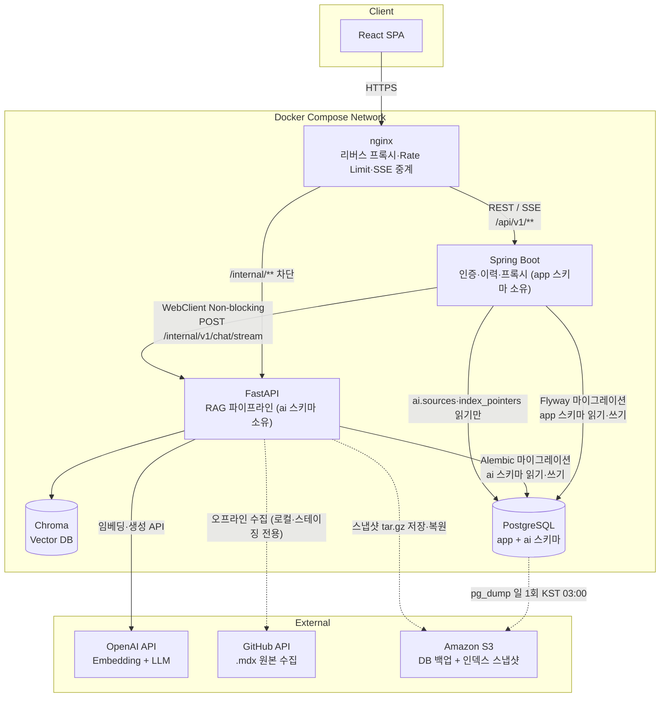

- **컨테이너 5개:** nginx, backend(Spring Boot), ai-server(FastAPI), chroma, postgres — `docker-compose up`으로 통합 실행
- **네트워크 경계:** nginx만 외부 노출. ai-server `/internal/**`는 nginx에서 차단 — 외부에서 직접 접근 불가
- **스키마 소유권:** `app` 스키마 = backend 독점 쓰기, `ai` 스키마 = ai-server 독점 쓰기. backend는 `ai.sources`, `ai.index_pointers` 읽기만 허용

---

### 1.2 논리 아키텍처 (계층별 책임)

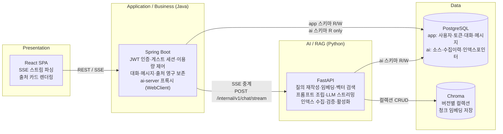

---

## 2. 인증·토큰

> 작성: 1인 프로젝트
>
- [ ] USED 유예 경합(409) 재시도 루프 단위 테스트 작성 필요

### 2.1 시퀀스 — 토큰 회전·재사용 탐지

```mermaid
sequenceDiagram
    participant U as Client
    participant BE as Spring Boot
    participant DB as PostgreSQL

    U->>BE: POST /api/v1/auth/refresh<br/>(Cookie: devdocs_rt=RAW_TOKEN)
    BE->>DB: SELECT rt.id, rt.status, rt.updated_at,<br/>tf.expires_at, tf.status AS family_status<br/>FROM refresh_tokens rt JOIN token_families tf<br/>ON rt.family_id = tf.id<br/>WHERE rt.token_hash = SHA256(RAW_TOKEN)<br/>FOR UPDATE OF rt

    alt 토큰 미존재 또는 패밀리 REVOKED
        DB-->>BE: (no row) or family_status=REVOKED
        BE-->>U: 401 AUTH_TOKEN_MISSING
    else 패밀리 expires_at 만료
        DB-->>BE: row (family_status=ACTIVE, tf.expires_at 경과)
        BE->>DB: UPDATE token_families SET status=REVOKED WHERE id=?
        BE-->>U: 401 AUTH_TOKEN_EXPIRED + Set-Cookie: devdocs_rt=; Max-Age=0
    else USED — 유예 5초 이내 재제출 (다중 탭 경합)
        DB-->>BE: row (rt.status=USED, rt.updated_at > NOW()-5s)
        BE-->>U: 409 AUTH_REFRESH_CONFLICT
        Note over U: 쿠키는 이미 새 토큰 보유.<br/>클라이언트 1회 재시도 (single-flight Promise)
    else USED — 유예 5초 초과 (재사용 탐지)
        DB-->>BE: row (rt.status=USED, rt.updated_at ≤ NOW()-5s)
        Note over BE: INV-15 위반 탐지 → 패밀리 전체 REVOKE
        BE->>DB: UPDATE refresh_tokens SET status=REVOKED<br/>WHERE family_id=? [패밀리 전체]
        BE->>DB: UPDATE token_families SET status=REVOKED WHERE id=?
        BE-->>U: 401 AUTH_REFRESH_REUSED + Set-Cookie: devdocs_rt=; Max-Age=0
    else ACTIVE — 정상 회전
        DB-->>BE: row (rt.status=ACTIVE, tf.expires_at 유효)
        BE->>DB: BEGIN
        BE->>DB: UPDATE refresh_tokens SET status=USED,<br/>updated_at=NOW() WHERE id=? [기존 ACTIVE → USED]
        BE->>DB: INSERT refresh_tokens (new_hash, ACTIVE, family_id)
        BE->>DB: COMMIT
        Note over DB: 트랜잭션 내 INV-15 보장:<br/>ACTIVE 1개 → USED, 신규 ACTIVE 1개
        BE->>BE: generateAccessToken(user_id, role, jti=UUID)
        BE-->>U: 200 {accessToken} + Set-Cookie: devdocs_rt=NEW_TOKEN
    end
```

---

### 2.2 상태 전이 — token_families

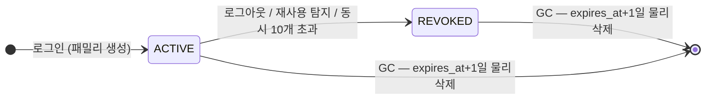

---

### 2.3 상태 전이 — refresh_tokens

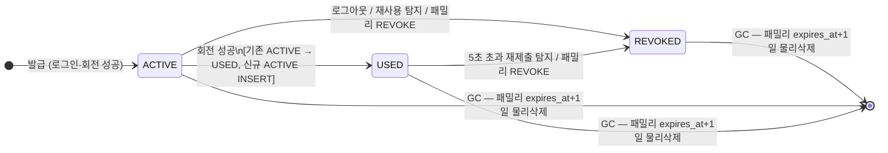

> **USED 5초 이내 재제출** → 상태 변경 없이 409 CONFLICT 반환. 자기 전이(USED→USED)가 아니라 응답만 분기되는 런타임 판정임.

---

## 3. 게스트 세션

> 작성: 1인 프로젝트
>
- [ ] 전시회 당일 IP당 신규 세션 30→60 조정 반영 확인

### 3.1 상태 전이 — guest_sessions

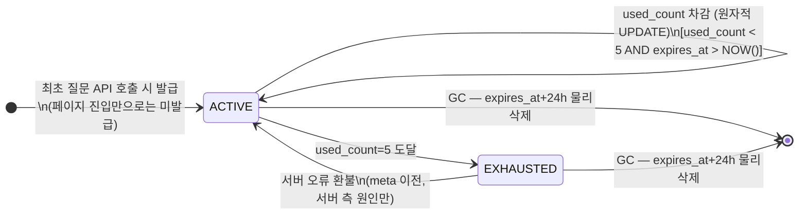

> **원자적 차감:** `UPDATE guest_sessions SET used_count=used_count+1 WHERE sid_hash=? AND used_count < 5 AND expires_at > NOW()`. 영향 행 0 → 429 GUEST_QUOTA_EXCEEDED.

---

## 4. 이용량

> 작성: 1인 프로젝트
>
- [ ] idx_messages_user_role_created 복합 인덱스 생성 확인 필요

> **스케줄러 없음.** 일일 할당량은 `messages.quota_cost` SUM COUNT 방식(런타임 판정). `KST 00:00 초기화`는 `created_at >= KST 오늘 00:00` 조건으로 자동 달성. 별도 배치 초기화 불필요.

### 4.1 판정 — 일일 이용량 검사·차감

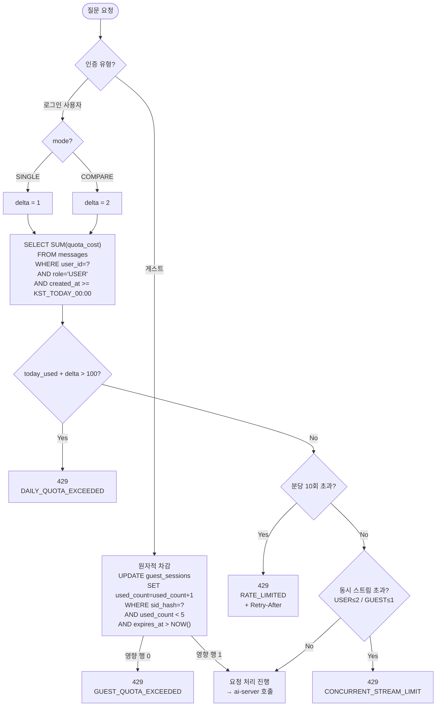

> **COUNT 쿼리 최적화:** `(user_id, role, created_at DESC)` 복합 인덱스 필수. 일일 최대 100회 제한으로 스캔 범위가 작아 t3.small에서도 충분.
> **자정 경계:** `created_at >= DATE_TRUNC('day', NOW() AT TIME ZONE 'Asia/Seoul') AT TIME ZONE 'Asia/Seoul'`으로 KST 기준 정확히 판정.

---

## 5. 질의응답·메시지

> 작성: 1인 프로젝트
>
- [ ] 스위퍼와 done 이벤트 동시 UPDATE 충돌 시나리오 단위 테스트 작성 필요

### 5.1 시퀀스 — 단일 모드 질의응답

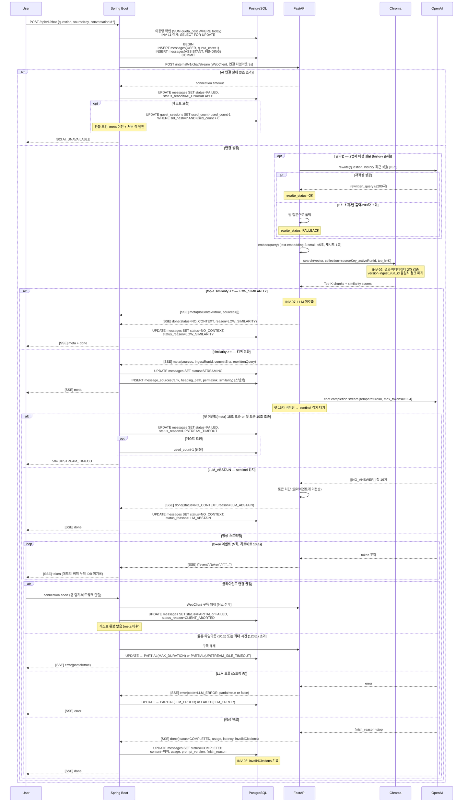

---

### 5.2 시퀀스 — 버전 비교 모드

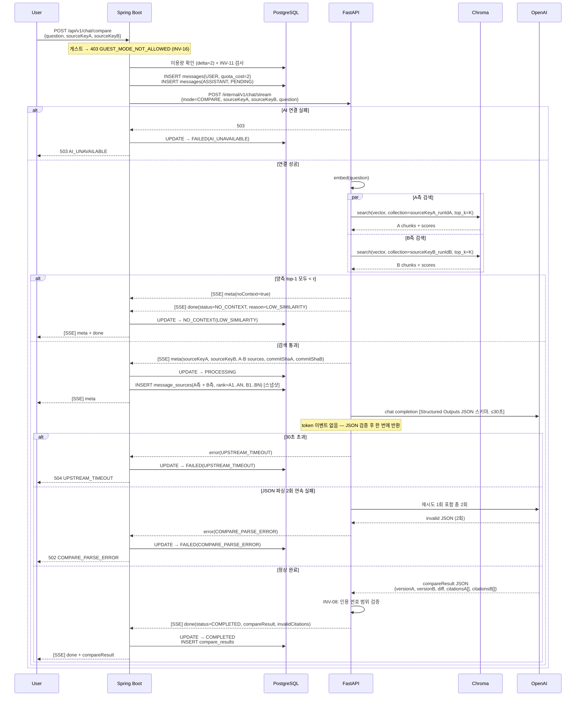

---

### 5.3 상태 전이 — app.messages (ASSISTANT)

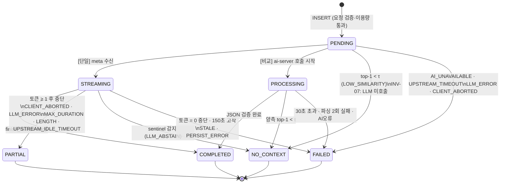

> **INV-12:** 종결 상태 4개(COMPLETED·PARTIAL·NO_CONTEXT·FAILED)에서 나가는 전이 없음. `canTransition(from, to)` 단위 테스트 필수.

---

## 6. 인덱스 관리

> 작성: 1인 프로젝트
>
- [ ] VALIDATING 게이트 10분 제한 타임아웃 구현 방식 확인 필요

### 6.1 시퀀스 — 수집 트리거·활성화

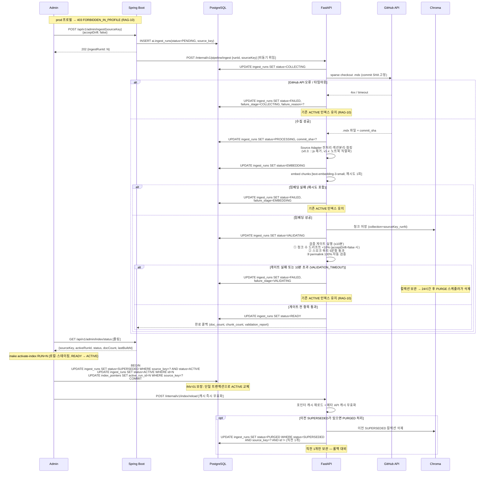

---

### 6.2 상태 전이 — ai.ingest_runs

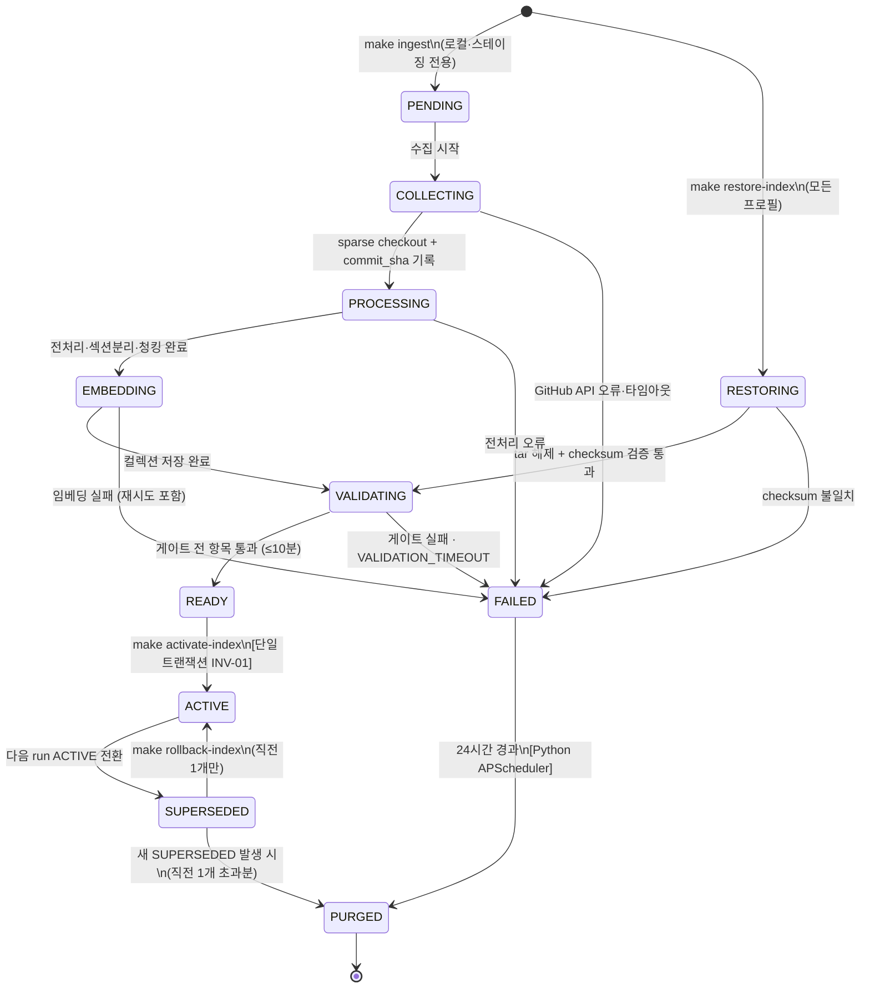

> **INV-01:** source_key별 ACTIVE ingest_run 정확히 1개. READY→ACTIVE 전환은 단일 트랜잭션.
> **INV-04:** `chunk_id = SHA-256(source_key, commit_sha, file_path, heading_path, chunk_index, chunk_strategy, chunk_params_hash)[:32]` — 동일 SHA 재수집 시 동일 chunk_id 집합.

---

## 부록

### A. 서비스 간 종단 흐름

| 흐름 | 이어 붙일 절 | 상태 |
| --- | --- | --- |
| 단일 질문 전체 (이용량 확인 → 스트리밍 → 저장) | 4.1 → 5.1 | |
| 비교 질문 전체 (이용량 2회 차감 → 병렬 검색 → JSON 응답) | 4.1 → 5.2 | |
| 토큰 회전 → 재사용 탐지 전파 | 2.1 → 2.2 → 2.3 | |
| 인덱스 수집 → 활성화 → 기존 인덱스 교체 | 6.1 → 6.2 | |
| 게스트 세션 발급 → 한도 소진 → 환불 → 만료 | 3.1 | |

---

| 버전 | 내용 |
| --- | --- |
| v0.3 | §5.2 compare 엔드포인트·요청바디 수정, §6.2 INV-01 source_key 수정 |

---

end.
